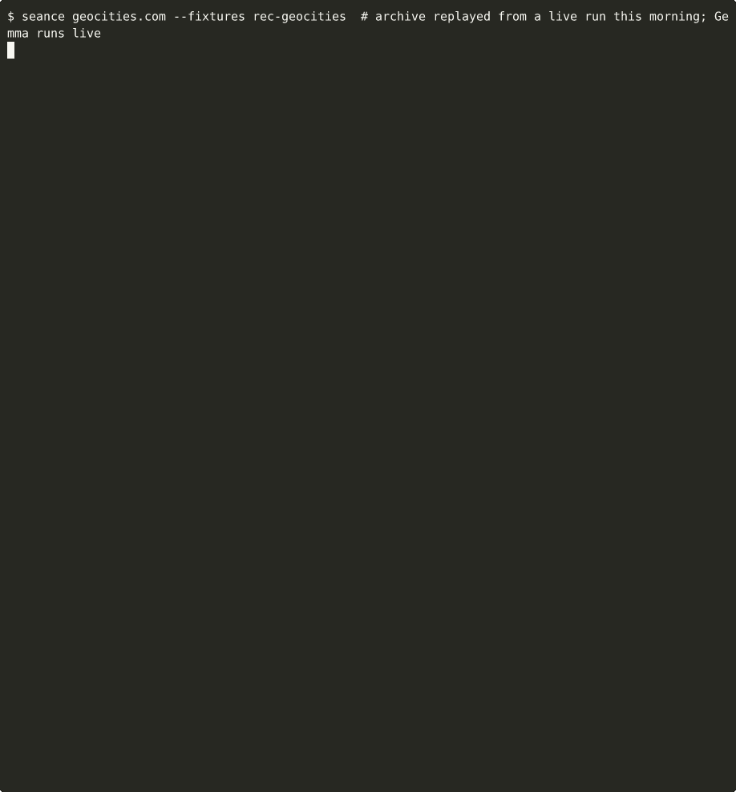

# Wayback Séance · 网页招魂

[](https://github.com/ziwenqingshu/wayback-seance/actions/workflows/ci.yml)
[](LICENSE)


**Give it the address of a dead website. It calls the site's ghost back from the Internet Archive, and the ghost
tells you its life story in the first person: birth, glory years, decline, last words.**

The catch, and the whole point: **the ghost may only remember what the archive kept.** Every sentence it speaks has
to cite a real Wayback Machine snapshot, and a deterministic checker holds each sentence up to that snapshot before
you get to see it. Sentences that don't match are struck through and "silenced by the medium".

The ghost's voice is a small **open-weight model running on your own CPU** (Gemma 3 4B through llama.cpp by
default). No API keys, no cloud, no account.



**Live ofrendas:** [geocities.com](https://ziwenqingshu.github.io/wayback-seance/geocities.html) ·
[del.icio.us](https://ziwenqingshu.github.io/wayback-seance/del.html) ·
[vine.co](https://ziwenqingshu.github.io/wayback-seance/vine.html) ·
[geocities.com (中文)](https://ziwenqingshu.github.io/wayback-seance/geocities.zh.html)

---

## Why

Ask a small model to "speak as the ghost of GeoCities" and it will warmly remember dancing babies and animated GIFs.
Maybe they were there. None of the snapshots it was given mention them. A ghost story that makes up its own past
isn't a remembrance, it's fan fiction.

So Wayback Séance splits the job: **the archive supplies the memories, the model supplies the voice, and plain code
checks that the two agree.**

## Install

Python 3.12+. The package itself has **no runtime dependencies** (stdlib only).

```bash
pip install git+https://github.com/ziwenqingshu/wayback-seance
# or: uv tool install git+https://github.com/ziwenqingshu/wayback-seance
```

Start a local model. Any OpenAI-compatible server works; the default is llama.cpp:

```bash
llama-server -hf unsloth/gemma-3-4b-it-GGUF:Q4_0 --port 8080 -c 4096
# or with Docker:
docker run -p 127.0.0.1:8080:8080 -v ~/models:/models ghcr.io/ggml-org/llama.cpp:server \
  -m /models/gemma-3-4b-it-Q4_0.gguf -c 4096 --host 0.0.0.0 --port 8080
# or Ollama:
ollama run gemma3:4b
```

## Use

```bash
seance geocities.com                # terminal séance + geocities-com.ofrenda.html
seance del.icio.us --lang zh        # the ghost speaks Chinese (中文)
seance vine.co --strict             # drop unverified sentences instead of striking them
seance del.icio.us -n 9            # summon 9 snapshots instead of 7
seance geocities.com --backend fake --fixtures tests/fixtures/geocities   # fully offline rehearsal
```

| Option | What it does |
|---|---|
| `-n, --snapshots N` | how many snapshots to summon (default 7) |
| `--lang en\|zh` | language of the testimony |
| `-o, --out FILE` / `--no-html` | where to lay the HTML ofrenda, or skip it |
| `--json FILE` | the full testimony with every verdict and reason |
| `--strict` | silenced sentences vanish instead of being shown struck through |
| `--backend auto\|openai\|llama-cpp\|fake` | `auto` tries `127.0.0.1:8080`, then Ollama on `:11434`, then `--model-path` |
| `--base-url`, `--model`, `--model-path` | point at another server, model name, or a GGUF for in-process llama-cpp-python (`pip install 'wayback-seance[llama-cpp]'`) |
| `--record DIR` / `--fixtures DIR` | save archive responses, or replay them with no network |
| `--pace S` | seconds per character while the ghost "speaks" |

Environment: `SEANCE_BASE_URL`, `SEANCE_MODEL`, `SEANCE_OLLAMA_MODEL`, `SEANCE_MODEL_PATH`, `NO_COLOR`.

## How it works

```
url ─► CDX index (one capture per month) ─► pick 7 snapshots spread over its life
    ─► fetch raw HTML (web.archive.org/web/<ts>id_/<url>) ─► extract title, description, visible text
    ─► count the afterlife: busiest year, when redirects took over, where they point
    ─► 4 chapters × (prompt with only that era's snapshots ─► Gemma streams ─► sentence segmenter ─► checker)
    ─► terminal séance + self-contained HTML ofrenda
```

1. **The Wayback pipeline** (`wayback.py`, `evidence.py`). The CDX API lists every capture, collapsed to one per
   month. Snapshots are chosen evenly across time with distinct content digests. `id_` URLs return the page exactly
   as the crawler saw it. Some captures are empty shells (a bare redirect, a gzip body, a script-only page). Those are
   detected, and the widest gap in the timeline gets filled with another capture, on a fixed fetch budget so the
   archive isn't hammered.
2. **Chapters, not one big prompt** (`prompts.py`). Birth sees the first snapshots, glory and decline see the middle,
   and last words see the final page plus the facts about its afterlife. The model is told to cite like `[S3]` and to
   put the words it remembers in quotes.
3. **The medium's post-check** (`grounding.py`). As tokens stream in, a segmenter cuts complete sentences (keeping a
   trailing `[S3]` attached and never splitting inside a quotation), and each one is judged against the text of the
   snapshot it cites:
   - it must cite something, and the snapshot must exist;
   - every quoted phrase must appear there (small slips like plurals are forgiven, invented phrases are not);
   - every year and number must appear there, or in the counted facts;
   - capitalised names it drops must appear there;
   - and enough of its content words must come from it.

   The result is **grounded**, **faint** (a real quote wrapped in invented embroidery, or a citation from another
   chapter), or **silenced**. In `--lang zh` the ghost speaks Chinese but must still quote the original English words,
   so the same checks apply.
4. **The ofrenda** (`ofrenda.py`). One HTML file with no external assets: papel picado, candles, a chart of the
   site's captures per year (living pages, redirects, errors), the testimony with a citation chip on every sentence
   linking to its snapshot, the silenced words kept struck through, and the relics themselves.

The checker is deliberately simple and lexical. It can't prove a sentence *true*; it proves the sentence's checkable
parts (quotes, names, numbers, years, vocabulary) came from the cited page. It catches the lies small models
actually tell here: invented quotes, borrowed facts from the wrong year, names from their training data.

## Development

```bash
uv sync --group dev
uv run ruff check . && uv run ruff format --check .
uv run pytest --cov
```

The tests never touch the network. The archive is replayed from recorded GeoCities responses in
`tests/fixtures/geocities`, and the model is a deterministic fake that quotes snapshot titles and tells exactly one lie
per chapter ("Millions of visitors adored my Dancing Baby animation"), so the tests can watch the medium catch it.

`scripts/record-demo.sh` re-records the demo GIF from a real, live séance.

---

## 中文说明

**网页招魂 (Wayback Séance)**：输入一个已经消失或面目全非的网站地址，它会从互联网档案馆 (Wayback Machine) 召回这个网站的幽灵，让它用第一人称讲述自己的一生：诞生、鼎盛、衰落、遗言。

关键在于：**幽灵只能记得档案馆真正保存下来的东西。** 它说的每一句话都必须引用一张真实的快照（日期 + 存档链接）。在你看到之前，一个确定性的检查器会把每句话和它引用的快照逐一比对：引语、年份、数字、名字都必须出现在快照里。对不上的句子会被划掉，标为"被灵媒噤声"。

- **完全本地**：默认使用开源权重模型 Gemma 3 4B，经 llama.cpp 在普通 CPU 上运行；也支持 Ollama 和任何 OpenAI 兼容接口。不需要 API Key，不需要注册账号。
- **中文模式**：`seance geocities.com --lang zh`。幽灵用中文讲述，但必须用双引号原样引用快照里的英文原词，所以同样可以核查。
- **两种输出**：终端里逐句"显灵"的招魂仪式，以及一个自包含的 HTML 祭坛 (ofrenda)：金盏花、蜡烛、快照时间线、每句证词旁可点击的引用标记。
- **离线测试**：测试使用录制好的 GeoCities 存档响应和一个假模型，完全不联网。

```bash
llama-server -hf unsloth/gemma-3-4b-it-GGUF:Q4_0 --port 8080 -c 4096
seance geocities.com --lang zh
```

在线示例：[geocities.com（中文）](https://ziwenqingshu.github.io/wayback-seance/geocities.zh.html)

---

MIT © 2026 Zhixin Qin. Snapshots courtesy of the [Internet Archive](https://archive.org/donate); please support it.
See [CREDITS.md](CREDITS.md).
